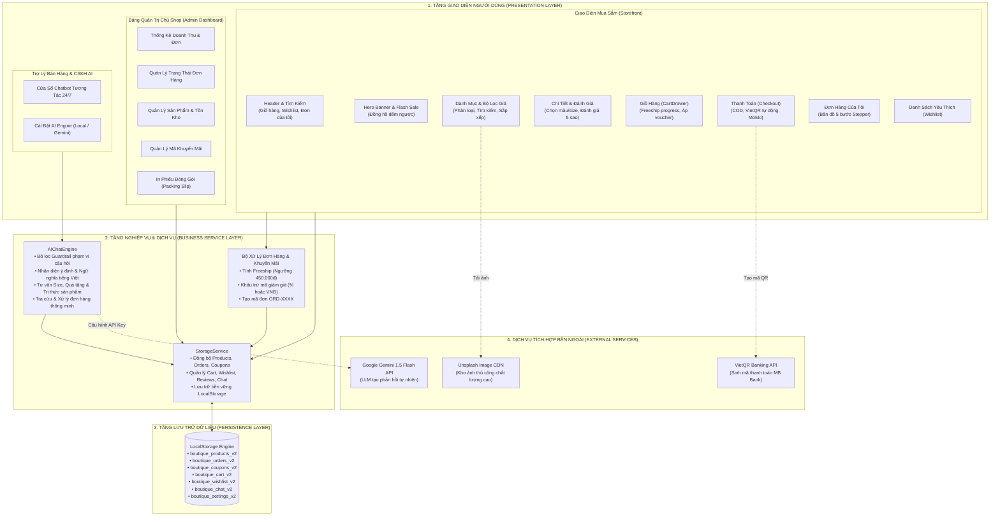
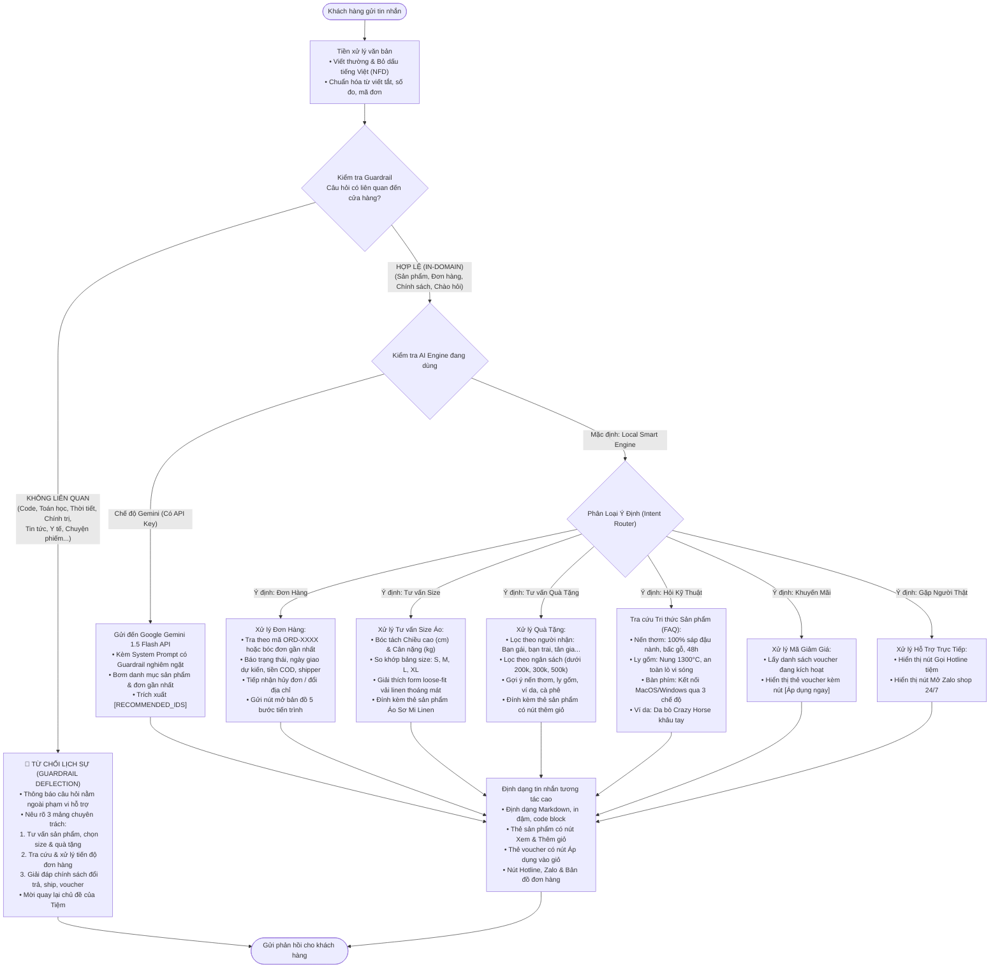
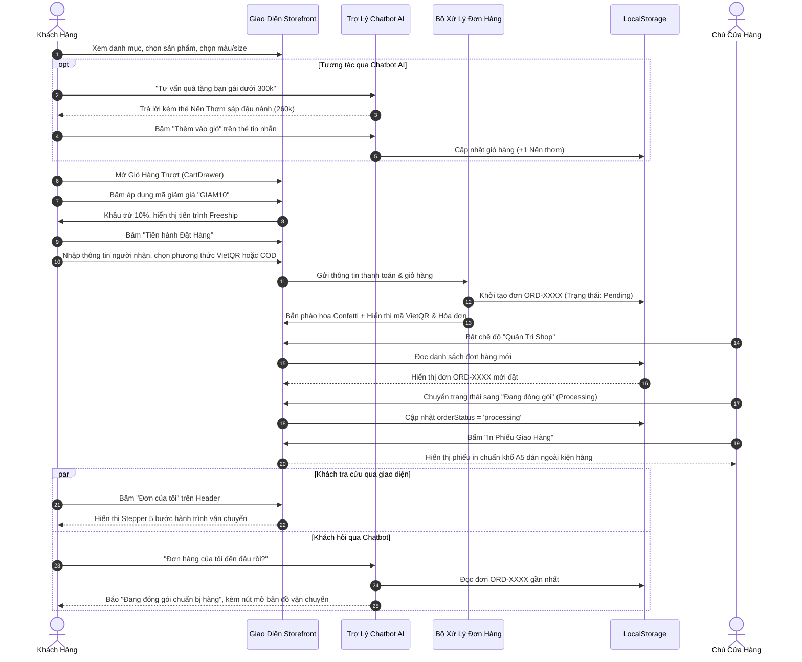
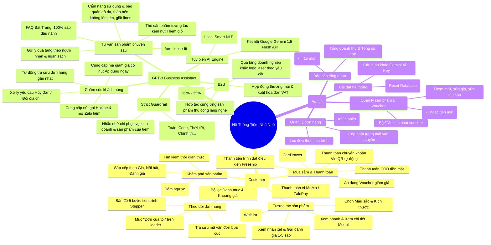
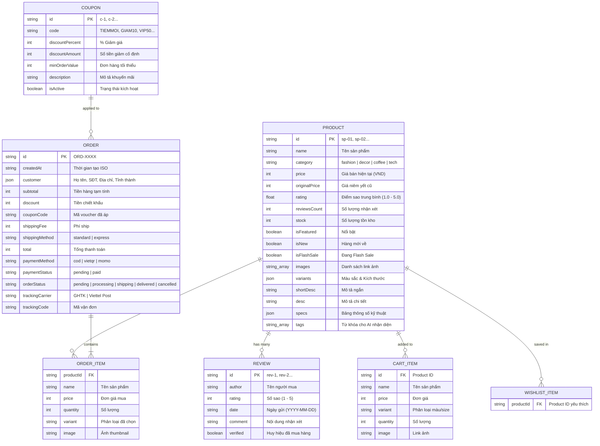

# SƠ ĐỒ ĐẶC TẢ HỆ THỐNG (TỆP ĐỘC LẬP)
## Dự Án: Tiệm Nhà Nhỏ - E-Commerce Mini Shop AI
*Tệp tài liệu kỹ thuật riêng biệt - Không đính kèm vào mã nguồn Web*

---

## 1. Sơ Đồ Kiến Trúc Hệ Thống Tổng Thể (3-Tier Layered Architecture)

---

## 2. Sơ Đồ Luồng Xử Lý AI & Cơ Chế Guardrail (Kiểm Soát Phạm Vi)

---

## 3. Sơ Đồ Vòng Đời Đơn Hàng & Mua Sắm (E-Commerce Sequence)

---

## 4. Sơ Đồ Phân Rã Chức Năng (Functional Decomposition)

---

## 5. Sơ Đồ Mô Hình Dữ Liệu Thực Thể (ERD)

